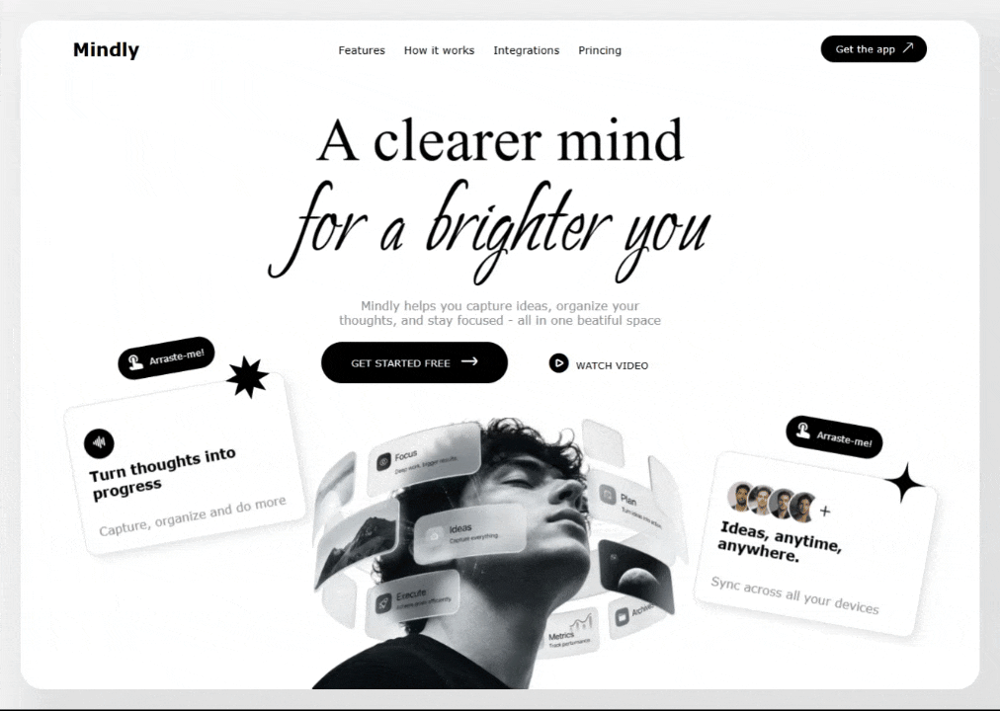
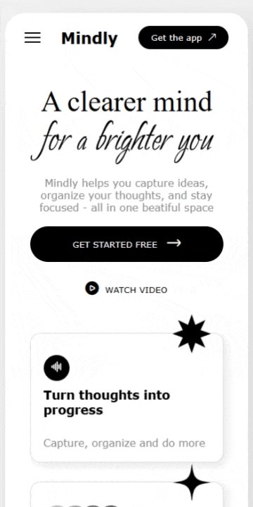

# Clear Mind

A responsive landing page featuring interactive animations, dynamic card movements, and a unique visual experience.

## ✨ About the Project

**Clear Mind** is a responsive landing page designed to explore creativity, movement, and interactive visual effects.

Its main highlight is the movement of cards across the screen, leaving a dotted trail that follows their paths and creates a dynamic, engaging experience.

The project combines modern design, smooth animations, and interactive elements to create a visually distinctive interface.

  
  

## 🚀 Features

- **Responsive Design:** Adapts to different screen sizes and devices.
- **Interactive Cards:** Dynamic card movements across the screen.
- **Dotted Trail Effect:** Particles follow the cards, creating a visual trail.
- **Smooth Animations:** Fluid movements and transitions for a more engaging experience.
- **Modern Interface:** A visually appealing layout focused on movement and interaction.

## 🛠️ Technologies

  

## 🎨 Visual Experience

The project uses animated cards as its main visual element.

As the cards move across the screen, a dotted trail follows their movements, creating a sense of continuity and adding depth to the interaction.

The goal is to deliver a distinctive visual experience while maintaining a clean layout and responsive behavior.

## 📱 Responsiveness

The interface is designed to adapt to different screen sizes, maintaining its visual structure and usability across desktop and mobile devices.

Responsive layouts and CSS media queries help ensure a consistent experience across different resolutions.

## 🎯 Project Goals

- Explore interactive web animations.
- Experiment with the Canvas API and particle effects.
- Create a responsive and visually engaging landing page.
- Improve frontend development skills through creative UI interactions.

Developed as a frontend project focused on interactive design, animation, and responsive web development.
